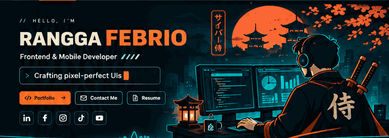
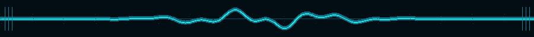

<!--
  RANGGA FEBRIO — CYBER SAMURAI / GITHUB PROFILE
  Install: copy this README.md and the assets/ folder into
  the special public GitHub repository RanggaFebrio25/RanggaFebrio25.
  Then add .github/workflows/snake.yml and run it once.
  Colors: #08151D #D8502A #2AA8C8 #F0E8D0
-->

  

  
  
<strong>Developer · Builder · UI/UX Enthusiast · Cyber Samurai</strong>

  
<em>Crafting pixel-perfect interfaces, reliable systems, and memorable digital experiences.</em>

  
  
  

 

  
  
  
  
  
  

 

  
  
  

  <h3>「 Design with intention. Code with precision. Build with passion. 」</h3>
  Modern engineering with a Neo-Brutalism × Cyber Samurai mindset.

 

<!-- ABOUT + MISSION CONTROL -->
## 🥷 About Me / My Journey

<table width="100%">
  <tr>
    <td width="60%" valign="top">
      <h3>👋 Hello, I'm Rangga!</h3>
      
I'm a <b>Frontend &amp; Mobile Developer</b> from Indonesia. I love turning complex workflows into interfaces that feel simple, fast, and delightful — without ignoring performance, scalability, or maintainability.

      <ul>
        <li>💼 <b>Current role:</b> Lead Frontend &amp; Mobile Developer at <b>PT Hasel Milek Jaya</b></li>
        <li>🔭 <b>Building:</b> Check Spot (Smart Attendance) and Dscale (Weighbridge System)</li>
        <li>🌱 <b>Exploring:</b> Three.js, Spline, WebSocket, and hardware integrations</li>
        <li>🎨 <b>Design signature:</b> Neo-Brutalism × Cyber Samurai</li>
        <li>💬 <b>Ask me about:</b> Next.js, Flutter, UI/UX, APIs, and architecture</li>
        <li>⚡ <b>Fun fact:</b> I enjoy designing SQL schemas and pixel-perfect micro-interactions.</li>
      </ul>
    </td>
    <td width="40%" valign="top">
      <h3>⚡ Mission Control</h3>
      

      
<b>Current projects</b>

      
☑️ Check Spot — Smart attendance

      
☑️ Dscale — Weighbridge system

      
<b>Current focus</b>

      

        
        
        
        
      

    </td>
  </tr>
</table>

<!-- FEATURED WORK -->
## 🚀 Featured Projects

  Products and systems I'm actively designing, developing, and improving.

 

<table width="100%">
  <tr>
    <td width="50%" valign="top">
      <h3>📍 Check Spot</h3>
      
<b>Smart Attendance Platform</b>

      
A modern attendance experience focused on faster check-ins, clear workflows, and a better administrative dashboard.

      

        
        
      

      <a href="https://www.syaraline.com/"><b>View Portfolio ↗</b></a>
    </td>
    <td width="50%" valign="top">
      <h3>⚖️ Dscale</h3>
      
<b>Weighbridge &amp; Operations System</b>

      
A cross-platform solution for weighing workflows, operational data, payment flows, reporting, and integrations.

      

        
        
      

      <a href="https://github.com/RanggaFebrio25?tab=repositories"><b>Explore My Work ↗</b></a>
    </td>
  </tr>
</table>

  

<!-- TECH STACK -->
## 🧩 Tech Stack & Tools

  <h3>🌐 Web & Mobile Development</h3>
  

  <h3>⚙️ Backend, Database & Cloud</h3>
  

  <h3>🎨 Design & Data Science</h3>
  

 

<!-- SPECIALTIES -->
## ⚔️ Craft, Principles & Specialties

<table width="100%">
  <tr>
    <td width="50%" valign="top">
      <h3>🛠️ Development Principles</h3>
      
✔ Build with purpose, not just features.

      
✔ Write clean, maintainable, scalable code.

      
✔ Treat performance and accessibility as essentials.

      
✔ Make complex processes feel intuitive.

      
✔ Keep learning, experimenting, and improving.

    </td>
    <td width="50%" valign="top">
      <h3>🎯 My Specialties</h3>
      

      

      

      

      

      

    </td>
  </tr>
</table>

<!-- ANALYTICS -->
## 📊 GitHub Analytics & Coding Stats

  Live, automatically generated cards — numbers are fetched from GitHub, not manually entered.

 

  

  
  

  
  

<!-- SNAKE -->
## 🐍 Contribution Snake

  Animated from my GitHub contribution grid. Regenerated automatically by GitHub Actions.

 

  <picture>
    <source media="(prefers-color-scheme: dark)" srcset="https://raw.githubusercontent.com/RanggaFebrio25/RanggaFebrio25/output/github-contribution-grid-snake-dark.svg" />
    <source media="(prefers-color-scheme: light)" srcset="https://raw.githubusercontent.com/RanggaFebrio25/RanggaFebrio25/output/github-contribution-grid-snake.svg" />
    
  </picture>

<!-- MILESTONES -->
## 🏆 Achievements & Milestones

  
  
  

 

  

<!-- NOW + NEXT -->
## 🗺️ Roadmap & Learning Now

<table width="100%">
  <tr>
    <td width="50%" valign="top">
      <h3>🗓️ My Developer Journey</h3>
      
✅ <b>Foundation:</b> Frontend development, UX, and data modeling

      
✅ <b>Real-world systems:</b> Build and improve Check Spot &amp; Dscale

      
🔄 <b>Now:</b> Refine performance, animations, and real-time features

      
🎯 <b>Next:</b> More experiments, reusable components, and open-source work

    </td>
    <td width="50%" valign="top">
      <h3>📚 Exploring Right Now</h3>
      
🎮 <b>3D Interfaces:</b> Three.js &amp; Spline

      
📡 <b>Realtime:</b> WebSockets &amp; hardware data

      
🏗️ <b>Architecture:</b> Maintainable full-stack systems

      
✨ <b>Experience:</b> Motion design &amp; micro-interactions

      

    </td>
  </tr>
</table>

<!-- TOOLS -->
## 🧰 My Developer Toolbox

  
  
Tools for shipping thoughtful products — from first wireframe to production.

<!-- QUOTE -->

  <h3>💭 Developer Philosophy</h3>
  <h2>“Less code equals less bugs.”</h2>
  — Kevlin Henney
  
Code is a craft. Simplicity is a feature. Good experiences are intentional.

<!-- CONTACT -->
## ✉️ Let's Build Something Great

  
Open to meaningful conversations, interesting technology, and creative collaborations.

  
  
  

 

  <h3>☕ Support My Work</h3>
  
If you enjoy my projects, designs, or open-source experiments, you can support my work.

  

 

  
  <h3>RANGGA FEBRIO</h3>
  Developer · Builder · Learner · Always Improving
   
  Crafted with discipline, caffeine, and curiosity.

